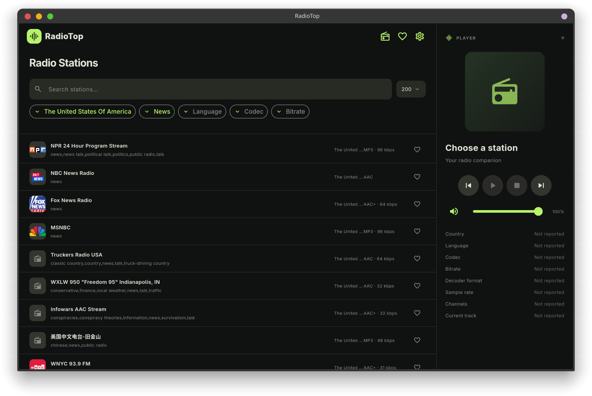
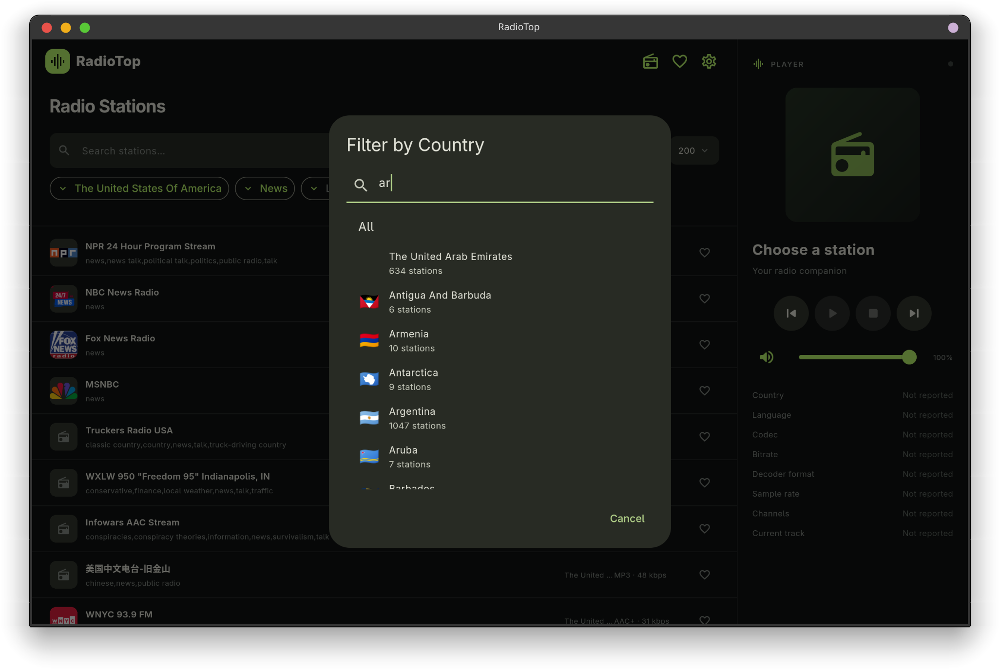
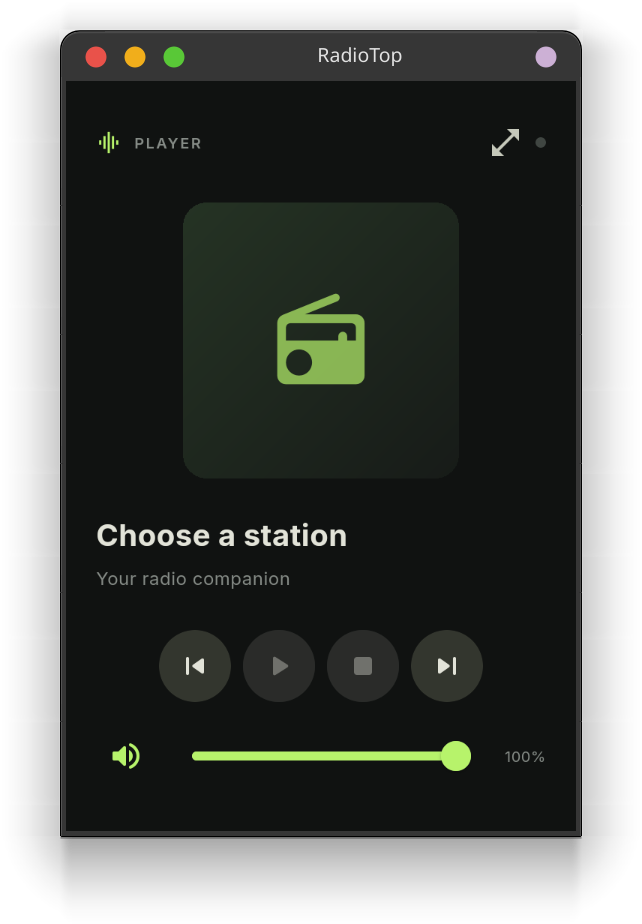

# RadioTop

RadioTop is a Linux desktop internet-radio browser and player built with Flutter.
It uses the Radio-Browser community catalog to load countries, genres, languages,
and stations dynamically. The interface is in English.

## Features

- Three-column desktop layout with navigation, searchable country/genre/language
  selectors, station results, and a player.
- Country flags and station counts; selecting a country, genre, or language loads
  matching stations.
- Configurable result count (100 by default), station artwork, and available
  catalog metadata.
- Playback through `media_kit` and its Linux MPV backend, including live ICY
  titles, buffering state, and decoder details when available.
- Configurable automatic reconnects and audio buffer duration.
- Favorites and preferences stored under `~/.config/radiotop/`.
- Radio-Browser server discovery and failover. Missing technical metadata is
  shown as unreported rather than inferred.

## Screenshots

### Station browser



### Searchable country filter



### Mini player



## Requirements

- Linux x86_64.
- [`just`](https://just.systems/) to use the project recipes.
- A working Flutter SDK (which includes Dart). `just` prefers a working
  `fvm flutter` and falls back to `flutter` on `PATH`. To choose explicitly:

  ```sh
  FLUTTER='fvm flutter' just run
  FLUTTER=flutter just build
  ```

If neither Flutter nor a configured FVM SDK is available, `just run` and
`just build` print setup guidance and stop.

Install [`just`](https://just.systems/man/en/) and either the
[Flutter SDK](https://docs.flutter.dev/get-started/install/linux) or
[FVM](https://fvm.app/documentation/getting-started/installation) with a
usable Flutter SDK installed or selected.

Linux desktop build dependencies on Debian/Ubuntu:

```sh
sudo apt-get update
sudo apt-get install -y clang cmake ninja-build pkg-config libgtk-3-dev liblzma-dev
```

On Arch Linux:

```sh
sudo pacman -S --needed clang cmake ninja pkgconf gtk3 just
```

For running a manually installed release on Debian/Ubuntu, install the Flutter
Linux runtime libraries if they are not already present:

```sh
sudo apt-get install libgtk-3-0 libblkid1 liblzma5
```

## Run and build from source

From the repository root:

```sh
just                 # list available recipes
just run             # run the Linux desktop app
just run --verbose   # pass additional Flutter arguments
just build           # create a versioned release build
```

The Flutter release bundle is written to
`build/linux/x64/release/bundle/`. To create the distributable archive,
including the bundle, desktop launcher, icons, and license:

```sh
just release-archive
```

The archive is written to `.release/radiotop-<version>-linux-x86_64.tar.gz`.
`just clean` removes the generated `.release/` directory.

## Install

### Arch Linux / AUR

Install the binary package with an AUR helper:

```sh
yay -S radiotop-bin
# or
paru -S radiotop-bin
```

It installs the Flutter bundle under `/usr/lib/radiotop`, the executable at
`/usr/bin/radiotop`, a desktop launcher under `/usr/share/applications/`, and
icons in the hicolor theme. The package declares GTK 3 as a runtime dependency.

### Install from this checkout on Arch Linux

With `base-devel` installed, use the same package definition and pacman package
management as the AUR installation:

```sh
just install
just uninstall
```

`just install` downloads the GitHub Release matching `VERSION`, builds the
`radiotop-bin` package with `makepkg`, and installs it with pacman. It does not
build uncommitted source changes. `just uninstall` removes the package but keeps
preferences and favorites in `~/.config/radiotop/`.

### Manual installation from a GitHub Release

Download the `radiotop-<version>-linux-x86_64.tar.gz` asset from the GitHub
Release, then extract and install it. Replace `0.9.0` below with the release
version you downloaded:

```sh
mkdir -p radiotop-release
tar -xzf radiotop-0.9.0-linux-x86_64.tar.gz -C radiotop-release

sudo install -d /usr/lib/radiotop
sudo cp -a radiotop-release/bundle/. /usr/lib/radiotop/
printf '%s\n' '#!/bin/sh' 'exec /usr/lib/radiotop/radiotop "$@"' | \
  sudo tee /usr/bin/radiotop > /dev/null
sudo chmod 755 /usr/bin/radiotop
sudo install -Dm644 radiotop-release/radiotop.desktop \
  /usr/share/applications/radiotop.desktop
sudo install -Dm644 radiotop-release/radiotop.png \
  /usr/share/icons/hicolor/256x256/apps/radiotop.png
sudo install -Dm644 radiotop-release/radiotop.svg \
  /usr/share/icons/hicolor/scalable/apps/radiotop.svg
sudo install -Dm644 radiotop-release/LICENSE \
  /usr/share/licenses/radiotop/LICENSE
```

After installation, launch RadioTop from the desktop application menu or run
`radiotop`. The GTK application ID is `com.mikelexp.radiotop`.

## Reproducible builds

Flutter 3.47.8 is pinned in `.fvmrc` and in the release workflow. It includes
Dart; `pubspec.lock` records the resolved Dart packages. Install FVM, then run
`fvm install` and `just build`. The build enforces the lockfile before compiling.
GitHub Actions also builds on pushes, pull requests, and a weekly schedule.

To preserve an offline copy of the Linux x86_64 Flutter SDK and the packages in
`pubspec.lock`, run `just backup-build-dependencies`. It downloads into the
project's `.toolchains/` and `.pub-cache/` directories and creates an archive and
checksum under `.build-backup/`. Copy both files to independent storage; these
generated files are not committed to Git. To restore them in a checkout, verify
the checksum, extract the archive in the project root, and run:

```sh
sha256sum -c .build-backup/SHA256SUMS
# Extract .build-backup/radiotop-build-dependencies-linux-x64.tar.gz here.
export FVM_CACHE_PATH="$PWD/.toolchains" PUB_CACHE="$PWD/.pub-cache"
fvm flutter pub get --offline --enforce-lockfile
fvm flutter build linux --release --no-pub
```

The backup does not include FVM, the operating system, or Linux build tools and
libraries (such as Clang, CMake, Ninja, GTK and liblzma). Preserve a compatible
Linux build environment separately; an offline SDK archive alone cannot guarantee
future builds. Update dependencies and the SDK deliberately, rebuild, and refresh
the backup after changes.

## Versioning and releases

`VERSION` is the canonical release version. `just set-version` synchronizes it
with `pubspec.yaml` and the AUR `PKGBUILD`. Version numbers must be plain
`major.minor.patch` values:

```sh
just version
just set-version 0.9.1
git add VERSION pubspec.yaml PKGBUILD
git commit -m "Prepare v0.9.1"
just release-github
```

`just release-github` pushes the `v<version>` tag to the Git remote named
`github`. The GitHub Actions workflow then builds with Flutter 3.47.8 and
publishes the release archive. `just release-github` only pushes the tag; it
does not publish from the local machine. Ensure the `github` remote points to
`git@github.com:mikelexp/RadioTop.git` (`git remote -v`) and that the tag's
commit contains the matching `VERSION`.

To publish `radiotop-bin` automatically as well:

1. Create/request the `radiotop-bin` package repository on AUR.
2. Add the GitHub repository variable `AUR_PUBLISH_ENABLED` with value `true`.
3. Add the repository secret `AUR_SSH_PRIVATE_KEY` with an SSH key authorized
   for the AUR account.

The AUR job is skipped until the variable is enabled. Manual AUR publishing
with `just aur-publish` requires an existing AUR repository, an authorized key
in `AUR_SSH_PRIVATE_KEY`, and an Arch Linux environment with `makepkg`, `git`,
and `openssh`. Generate the current archive first with `just release-archive`;
the corresponding GitHub Release must also exist before publishing the package.

## License

RadioTop is licensed under the GNU General Public License, version 3 or later.
The full license is installed with the package and included in release archives;
see [LICENSE](LICENSE).

## Troubleshooting

Radio-Browser may be temporarily unavailable. RadioTop discovers available API
mirrors, retries transient failures against other mirrors, and offers a manual
retry if all discovered servers are unavailable.
